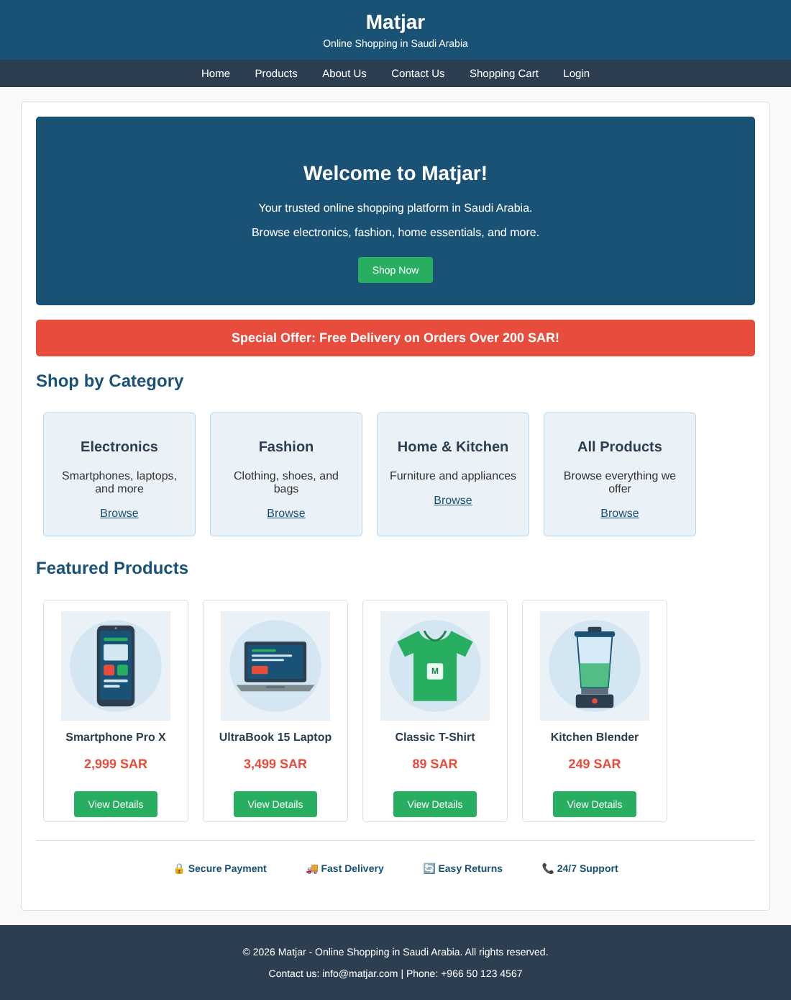
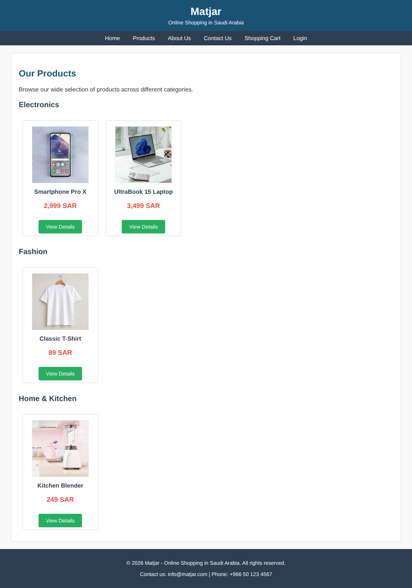
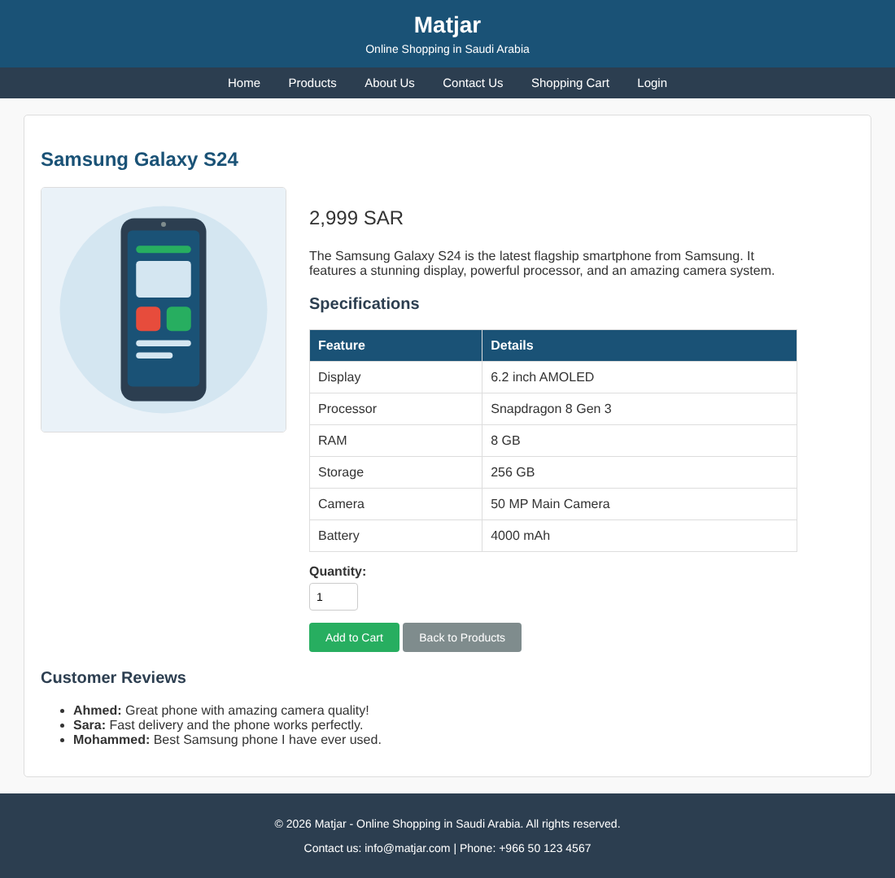
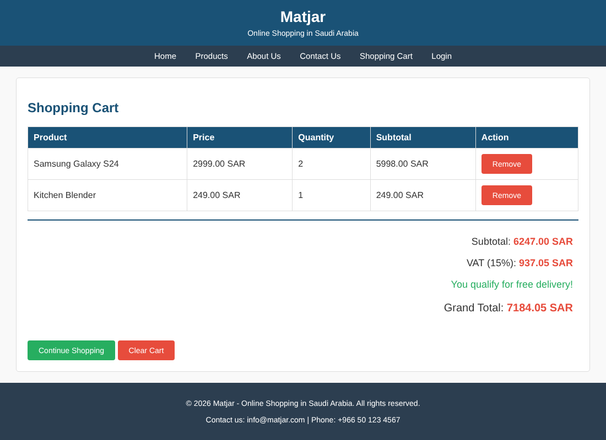
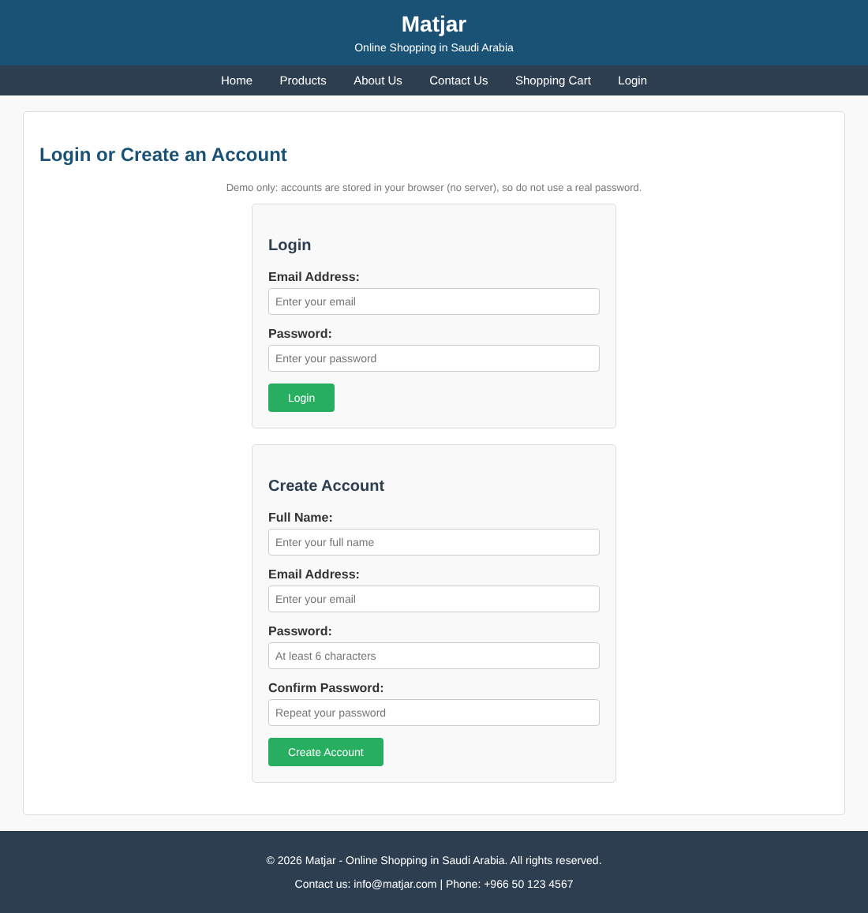
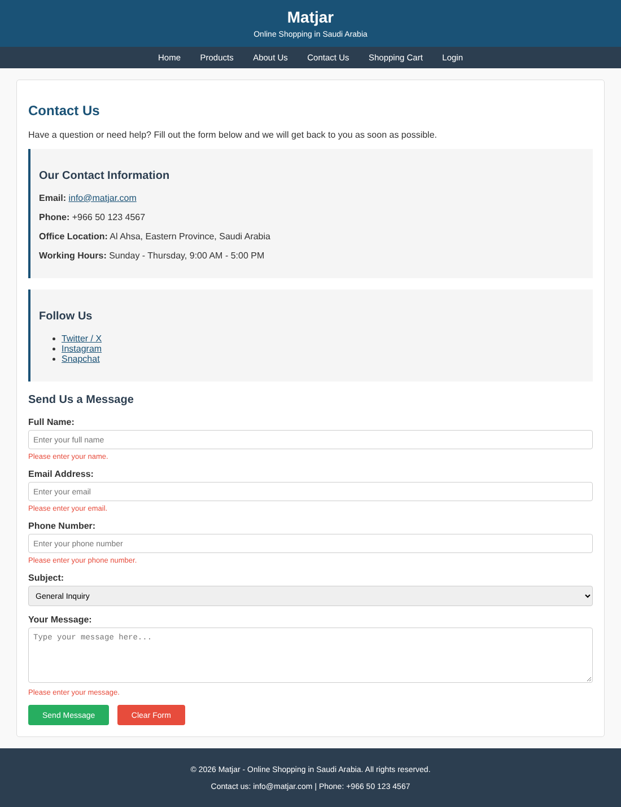

# Matjar – Online Shopping Website

A front-end online shopping website for Saudi Arabia, built with **HTML5, CSS3 and vanilla JavaScript** (no frameworks).
Originally a team project for the *Web Systems Development* course; improved and extended afterwards.

## Features
- Home, Products, four product detail pages, About Us, Contact Us and Shopping Cart
- Shopping cart stored in `localStorage` (add, remove, clear, quantity merge)
- Automatic 15% VAT and grand total calculation
- Contact form with JavaScript validation (name, email format, numeric phone, message)
- Demo login / create-account page (browser-only, passwords hashed with SHA-256; no real backend)
- Responsive layout (`@media` query) and a single shared stylesheet

## Screenshots
| Home | Products |
|---|---|
|  |  |

| Product details | Shopping cart |
|---|---|
|  |  |

| Login / Create account | Contact form validation |
|---|---|
|  |  |

## Run locally
Open `index.html` in a browser – no build step needed.

## Project structure
```
index.html  products.html  product1-4.html  about.html  contact.html  cart.html  login.html
style.css   main.js        images/
```

## PHP + MySQL version
A database-backed version (accounts, reviews, orders) is in [`php-version/`](php-version/). It needs a PHP server and is not part of the GitHub Pages demo.

## Image credits
Product photos are from [Unsplash](https://unsplash.com) (free to use under the Unsplash License):
smartphone photo by Andrey Matveev, T-shirt photo by Avtar Singh, laptop and blender photos from Unsplash contributors.

## Team
Ali Yousef Alalawi, Mohammed Abdullah Alramadhan, Ahmed Hussain Alsaeed,
Hassan Abdullah Alsuhayyih, Mohammed Waled, Youssef Alattiyah
